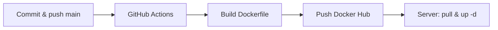

# Natal Next.js

Aplikasi [Next.js](https://nextjs.org) untuk Natal Gabungan. Deploy production memakai **Git → GitHub Actions → Docker Hub → server (docker pull & compose)**.

## Development lokal

```bash
npm install
cp .env.example .env.local   # isi nilai asli
npm run dev
```

Buka [http://localhost:3000](http://localhost:3000).

Atau dengan Docker (dev profile):

```bash
docker compose --profile dev up dev
```

---

## Persiapan sebelum deploy

### 1. Inisialisasi Git & remote

Pastikan folder ini sudah repository Git dan terhubung ke GitHub:

```bash
git init
git remote add origin https://github.com/<org-atau-user>/<repo>.git
git branch -M main
```

### 2. Environment variables

Salin template dan isi di mesin lokal (jangan commit file berisi secret):

```bash
cp .env.example .env.local
```

| Variabel | Dipakai saat | Keterangan |
|----------|--------------|------------|
| `NEXT_PUBLIC_SUPABASE_URL` | **Build** image | Masuk ke bundle Next.js |
| `NEXT_PUBLIC_SUPABASE_ANON_KEY` | **Build** image | Masuk ke bundle Next.js |
| `NEXT_PUBLIC_N8N_WEBHOOK_URL` | **Build** image | Masuk ke bundle Next.js |
| `GEMINI_API_KEY` | **Runtime** di container | Server-side only |
| `OPENROUTER_API_KEY` | **Runtime** | Server-side only |
| `SUPABASE_SERVICE_ROLE_KEY` | **Runtime** | Server-side only |

Variabel `NEXT_PUBLIC_*` **harus** ada di GitHub Secrets karena di-bake saat `docker build` di CI. Variabel runtime diisi di `.env` pada server (lihat bagian deploy server).

### 3. GitHub Secrets (repository → Settings → Secrets and variables → Actions)

Wajib untuk workflow [`.github/workflows/deploy.yml`](.github/workflows/deploy.yml):

| Secret | Contoh / isi |
|--------|----------------|
| `DOCKERHUB_USERNAME` | Username Docker Hub |
| `DOCKERHUB_TOKEN` | Access token Docker Hub (bukan password akun) |
| `NEXT_PUBLIC_SUPABASE_URL` | URL project Supabase |
| `NEXT_PUBLIC_SUPABASE_ANON_KEY` | Anon key Supabase |
| `NEXT_PUBLIC_N8N_WEBHOOK_URL` | URL webhook n8n |

### 4. Branch `main`

Workflow hanya jalan pada **push ke branch `main`**.

---

## Alur deploy: Git → GitHub Actions → Docker Hub



### Langkah di mesin developer

```bash
git add .
git commit -m "Deskripsi perubahan"
git push origin main
```

Setelah push, cek tab **Actions** di GitHub. Workflow **Natal NextJS Deploy** akan:

1. Checkout kode
2. Build image dari [`Dockerfile`](Dockerfile) dengan build-args dari secrets
3. Push ke Docker Hub dengan tag:
   - `<DOCKERHUB_USERNAME>/natal-nextjs-web:latest`
   - `<DOCKERHUB_USERNAME>/natal-nextjs-web:<git-sha>`

Image siap di-pull di server. Tidak perlu build manual di server untuk rilis normal.

### Build manual lokal (opsional, tanpa CI)

Hanya jika perlu uji image sebelum push ke GitHub:

```bash
docker build -t natal-nextjs-web:local \
  --build-arg NEXT_PUBLIC_SUPABASE_URL="..." \
  --build-arg NEXT_PUBLIC_SUPABASE_ANON_KEY="..." \
  --build-arg NEXT_PUBLIC_N8N_WEBHOOK_URL="..." \
  .

docker run -d --name natal-web -p 3000:3000 --env-file .env.local natal-nextjs-web:local
```

---

## Deploy di server (Docker pull & up -d)

Siapkan sekali di VPS/server production.

### 1. Login Docker Hub

```bash
docker login
```

### 2. File deploy di server

Buat folder deploy, misalnya `~/natal-nextjs`, lalu buat `.env` (runtime secrets, **jangan** commit ke Git):

```env
# Image dari Docker Hub (ganti USERNAME)
DOCKER_IMAGE=USERNAME/natal-nextjs-web:latest

# Runtime (tidak di-bake di CI untuk key ini)
GEMINI_API_KEY=...
OPENROUTER_API_KEY=...
SUPABASE_SERVICE_ROLE_KEY=...

# Opsional: referensi untuk dokumentasi (sudah di dalam image dari CI)
NEXT_PUBLIC_SUPABASE_URL=...
NEXT_PUBLIC_SUPABASE_ANON_KEY=...
NEXT_PUBLIC_N8N_WEBHOOK_URL=...
```

Buat `docker-compose.prod.yml` di server (atau salin dari repo dan sesuaikan):

```yaml
services:
  web:
    image: ${DOCKER_IMAGE}
    ports:
      - "3000:3000"
    env_file:
      - .env
    environment:
      - NODE_ENV=production
    restart: unless-stopped
    healthcheck:
      test: ["CMD", "wget", "--no-verbose", "--tries=1", "--spider", "http://localhost:3000"]
      interval: 30s
      timeout: 10s
      retries: 3
      start_period: 40s
```

Ganti `USERNAME` di `DOCKER_IMAGE` dengan username Docker Hub yang sama dengan secret `DOCKERHUB_USERNAME`.

### 3. Setiap kali ada rilis baru (setelah CI sukses)

```bash
cd ~/natal-nextjs
docker compose -f docker-compose.prod.yml pull
docker compose -f docker-compose.prod.yml up -d
```

Perintah `pull` mengambil tag `latest` terbaru dari Docker Hub; `up -d` me-restart container dengan image baru.

### 4. Verifikasi

```bash
docker compose -f docker-compose.prod.yml ps
docker compose -f docker-compose.prod.yml logs -f web
curl -I http://localhost:3000
```

Rollback ke commit tertentu: pull image dengan tag SHA dari GitHub Actions, misalnya `USERNAME/natal-nextjs-web:<commit-sha>`, lalu set `DOCKER_IMAGE` di `.env` server dan jalankan `up -d` lagi.

---

## Ringkasan peran file

| File | Fungsi |
|------|--------|
| [`.github/workflows/deploy.yml`](.github/workflows/deploy.yml) | CI: build & push ke Docker Hub saat push `main` |
| [`Dockerfile`](Dockerfile) | Production image (multi-stage) |
| [`docker-compose.yml`](docker-compose.yml) | Build/run lokal (bukan pull dari Hub) |
| [`.env.example`](.env.example) | Template variabel environment |

## Referensi

- [Next.js Documentation](https://nextjs.org/docs)
- [Next.js deployment](https://nextjs.org/docs/app/building-your-application/deploying)
